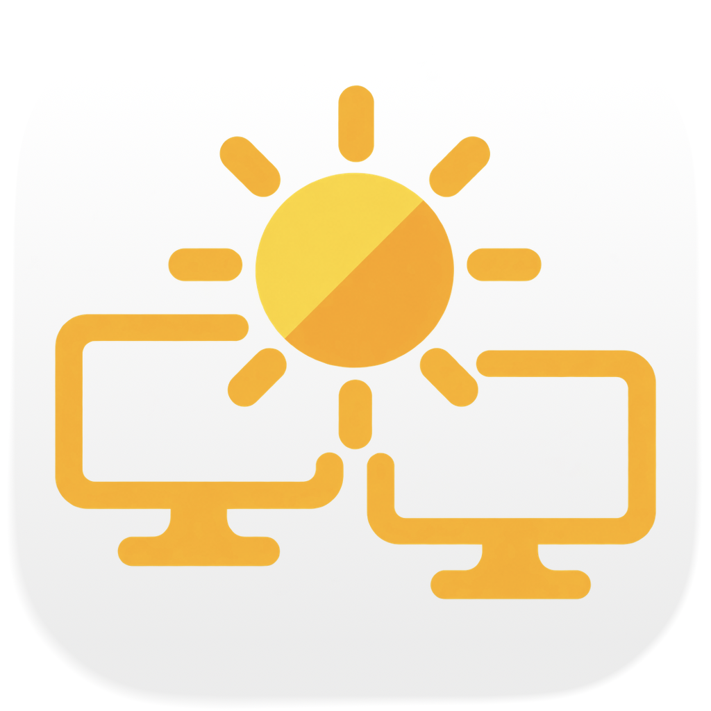

# BrightnessFollow / 亮度跟随

<picture>
  <source media="(prefers-color-scheme: dark)" srcset="Resources/AppIcon-dark.png">
  
</picture>

一个专注于 macOS 外接显示器亮度联动的菜单栏工具：读取 MacBook 内屏当前
亮度，并通过 DDC/CI 让外接显示器跟随。系统自动亮度和键盘手动调节都会同步。

## 功能

- 直接同步 MacBook 内屏当前亮度，而不是只同步亮度变化量。
- 可设置外屏亮度比例和最低亮度，修正不同面板的观感差异。
- 苹果键盘亮度键按鼠标所在屏幕分流：
  - 鼠标在内屏时，由 macOS 调整内屏，外屏随后跟随。
  - 鼠标在支持 DDC 的外屏时，直接调整该外屏。
- `Option + Shift` 保留 macOS 风格的四分之一档细调。
- 定时从 DDC 回读真实亮度；如果显示器自动亮度、DDPM 或其他工具覆盖写入，
  界面不会继续显示缓存出来的“同步成功”。
- 合盖时可以启用实验性的 Dell 自动亮度补偿和最低亮度保护。

## 兼容性与验证状态

- Apple Silicon Mac。
- macOS 13 或更高版本。
- 支持 DDC/CI 亮度控制的外接显示器。
- 已在 Dell U2725QE 通过 USB4 完成 DDC 读取、写入和回读验证。
- 原生 HDMI 使用同一套 DDC 检测与读写路径，但尚未在本项目中完成等价实测。
- 其他品牌和型号可能可用，但尚未建立兼容性列表。

本项目使用 macOS 私有的 DisplayServices 与 IOAVService 接口，不能提交 Mac
App Store；系统大版本升级后也可能需要适配。

## 使用前

1. 在显示器菜单中开启 DDC/CI。
2. 开盖跟随 MacBook 时，关闭显示器自带自动亮度。
3. 合盖使用 Dell 自动亮度增强时，保持 Dell 自动亮度开启。
4. 退出 DDPM、BetterDisplay、MonitorControl 等其他亮度控制工具，避免互相覆盖。
5. 首次启动后，在“系统设置 → 隐私与安全性 → 辅助功能”中允许本工具，
   以便拦截并按鼠标位置分流亮度键。

## 构建与正式发包

应用打包需要 Xcode 26 或更高版本，以编译 Icon Composer 原生图标资源。
应用本身仍支持 macOS 13；旧系统使用编译器生成的 ICNS 回退资源。
当前构建目标为 Apple Silicon（arm64）。

### 正式签名包

正式分发使用 **Developer ID Application** 证书、Hardened Runtime、安全时间戳
和 Apple 公证。按 [Apple 的公证要求](https://developer.apple.com/documentation/security/notarizing-macos-software-before-distribution)
验证完成后，才生成 `release.json` 与校验文件。Apple Development、本地自签和
ad-hoc 身份不能通过正式发包流程。

在钥匙串中安装带私钥的 Developer ID Application 证书，然后准备公证凭据。
已经有同一开发者团队的 `notarytool` Keychain profile 时可以直接复用；否则运行
下面的交互命令，按提示在本机输入 Apple ID、团队 ID 和专用密码：

```sh
xcrun notarytool store-credentials brightness-follow-notary
cp Scripts/release-config.example.sh .env.release.local
```

编辑 `.env.release.local`，填写完整证书名称、团队 ID 和 Keychain profile 名称。
该文件已被 Git 忽略；密码只保存在钥匙串，不要写进配置、命令参数或提交到仓库。
配置完成后，发包只需：

```sh
./Scripts/release.sh
```

如需先检查本地签名产物、暂不上传到 Apple，可先运行 `./Scripts/release.sh --prepare-only`；
这会生成同一冻结构建及待公证 ZIP，之后运行不带该选项的命令继续。

脚本会依次运行 Swift 测试、构建并签名应用、提交应用 ZIP 公证、装订应用票据，
再生成分发 ZIP 和带 `/Applications` 快捷入口的签名 DMG，完成 DMG 公证及票据装订。
最后重新解压 ZIP、挂载 DMG，检查里面的应用版本、Bundle ID、架构、签名团队、
可执行文件 SHA-256、票据及 Gatekeeper 结果。

产物位于 `.build/releases/<版本>-<构建号>-arm64/`：

- `BrightnessFollow-<版本>-arm64.dmg`：拖入“应用程序”即可安装。
- `BrightnessFollow-<版本>-arm64.zip`：包含已签名且已装订公证票据的应用。
- `SHA256SUMS`、`release.json`：成品校验值、版本、签名团队和两次公证的提交 ID。
- `.notary/`：原始提交包、公证回执、Apple 日志及测试与构建日志；不作为分发附件。

默认每次公证最多等待 10 分钟。等待超时以退出码 `2` 结束，再次运行同一命令会
复用原签名包与提交 ID，不会重新上传。仅查询一次、稍后续跑可以使用：

```sh
./Scripts/release.sh --wait-seconds 0
./Scripts/release.sh --verify-only
```

`--verify-only` 仅用于已经完整生成 `release.json` 的成品。网络或工具故障以非零
状态停止；若上传结果不明确，脚本会阻止自动重复上传。检查 `notarytool history`
和 `.notary/*.submit.json`，确认对应文件后，可用 `--app-submission <UUID>` 或
`--dmg-submission <UUID>` 恢复。`--output <目录>` 可指定独立输出目录。

同一输出目录代表一次冻结构建。修改源代码后要更新 `Resources/Info.plist` 中的
版本和构建号，再生成新包。此脚本准备可分发安装包，不会自动创建 GitHub Release。

### GitHub Actions

[CI 发布指南](docs/ci-release.md) 说明仓库 Secrets、版本标签、手动发布和公证超时恢复。
合入 `main` 后可通过 `Release macOS` 工作流完成同一套正式发包流程。

### 本机开发

```sh
swift test --disable-sandbox
/usr/bin/python3 -m unittest discover -s Tests/ReleasePipelineTests -v
./Scripts/create-local-signing-identity.sh
./Scripts/build-app.sh
open "$PWD/.build/app/BrightnessFollow.app"
```

本机开发仍可使用固定的 `BrightnessFollow Local Code Signing` 自签身份；创建脚本
会生成有效期十年的证书并将私钥保存在钥匙串。不要将这类构建用于对外分发。
构建脚本找不到稳定签名身份时会停止，不会回退到 ad-hoc 签名。

从旧本地自签版迁移到 Developer ID 版时，macOS 可能要求重新授予一次辅助功能
权限。Bundle ID 保持 `com.nick.brightnessfollow`，日常使用保持安装路径为
`/Applications/BrightnessFollow.app`。固定路径并不能保证跨签名身份沿用旧授权。

所有构建默认放在隐藏的 `.build/` 目录，避免被 Spotlight 和应用列表反复收录。
旧应用备份应压缩为 ZIP 存放，不要在项目根目录保留多份 `.app`。

## 应用图标

应用图标采用金黄色太阳与双显示器，以统一光源表达多屏亮度跟随。
`Resources/AppIcon.icon` 是原生 Icon Composer 源文件：浅色使用系统浅色底，
深色使用系统深色底，金色图案保持一致。前景宽度约占底板的 84%，比旧版更饱满。
支持原生图标外观的系统会跟随用户的图标外观设置；旧系统使用浅色 ICNS。
`Resources/AppIcon.png` 与 `Resources/AppIcon-dark.png` 仅为原生渲染的预览图，
不是构建时重新加工的底图。
设计提示词保存在 [AppIcon-design.md](Resources/AppIcon-design.md)。

修改 `.icon` 文档后运行 `./Scripts/build-icon.sh` 可以更新 ICNS 文件。
应用构建会同时生成并打包 `Assets.car` 和兼容旧系统的 `AppIcon.icns`，
并检查深色外观是否存在。菜单栏继续使用适配深浅外观的单色太阳符号。

## 诊断

```sh
swift run --disable-sandbox BrightnessFollow --probe
swift run --disable-sandbox BrightnessFollow --verify-ddc
```

`--probe` 只读取显示器状态。`--verify-ddc` 会把当前外屏亮度原值写回并再次
读取验证，不改变最终亮度。

## 隐私

应用不包含网络请求、账号系统或遥测。亮度配置保存在本机。

## 开源许可

项目使用 [MIT License](LICENSE)。Apple Silicon DDC 传输实现参考了
[MonitorControl](https://github.com/MonitorControl/MonitorControl)，详见
[THIRD_PARTY_NOTICES.md](THIRD_PARTY_NOTICES.md) 和
[MONITORCONTROL_LICENSE.txt](MONITORCONTROL_LICENSE.txt)。
